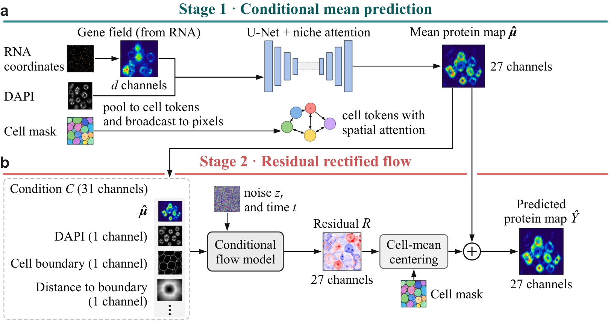

TxCellNet
=========

**Transferable generation of multiplexed protein images from spatial transcriptomics**

TxCellNet generates multiplexed protein images from imaging-based spatial transcriptomics. It reads what every
imaging-based section provides: the position and gene of each transcript molecule, the DAPI image and the cell
segmentation. Each molecule is replaced by a learnable embedding of its gene, and the embeddings are summed at the
molecule's pixel, so one model reads any gene panel (the panel genes in its training vocabulary). A U-Net reads this gene
field together with DAPI, and a cell-neighborhood transformer lets every cell attend to the other cells of the window.
Stage 1 predicts the conditional-mean protein image; its mean over the pixels of a cell is that cell's protein
prediction. To transfer to other tissues, gene panels, detection depths and imaging conditions, TxCellNet averages
networks trained on clean data and networks trained on randomized data (molecule thinning, gene dropout and DAPI
perturbation). Stage 2 is a rectified-flow model conditioned on the stage-1 image, DAPI and cell geometry; it adds the
sub-cellular texture of measured images while every cell keeps its stage-1 value. Cell values are taken from the
stage-1 image; the refined image is for reading and side-by-side comparison with measured images.

Code: `github.com/wrab12/TxCellNet <https://github.com/wrab12/TxCellNet>`_

.. toctree::
   :maxdepth: 2
   :caption: Contents

   installation
   tutorials
   data
   reproduce
   api
   credits
